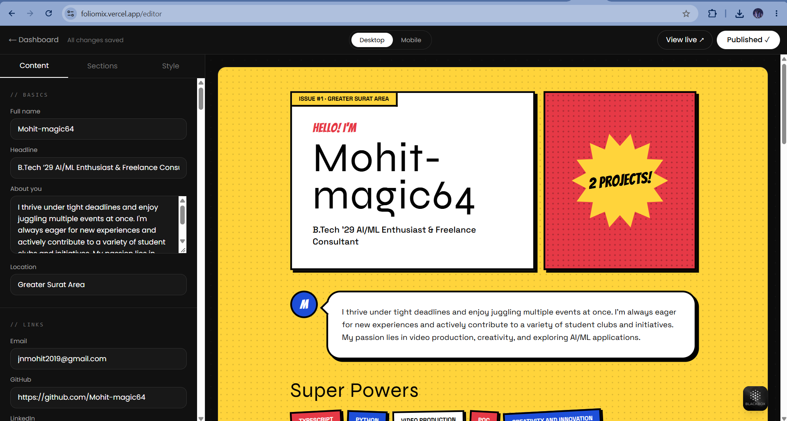
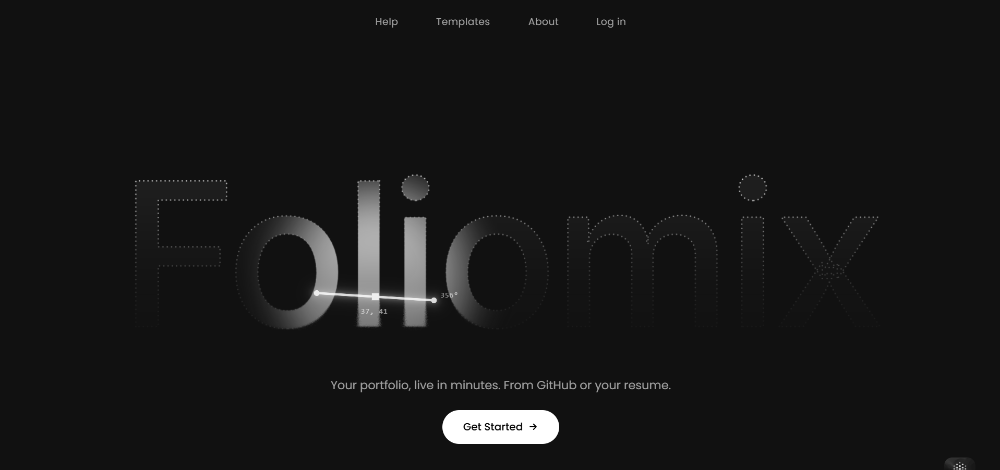
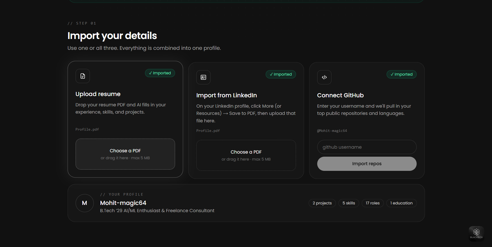
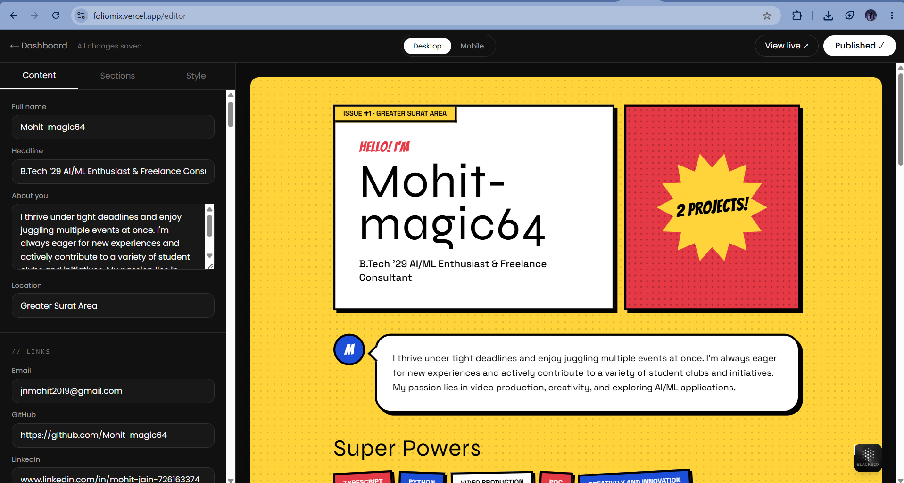
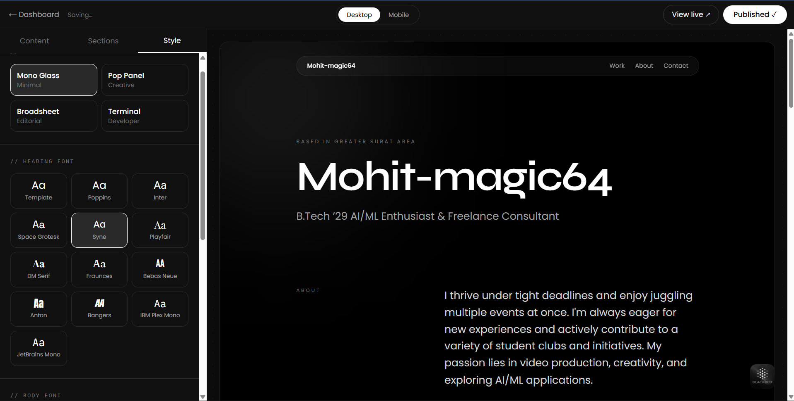
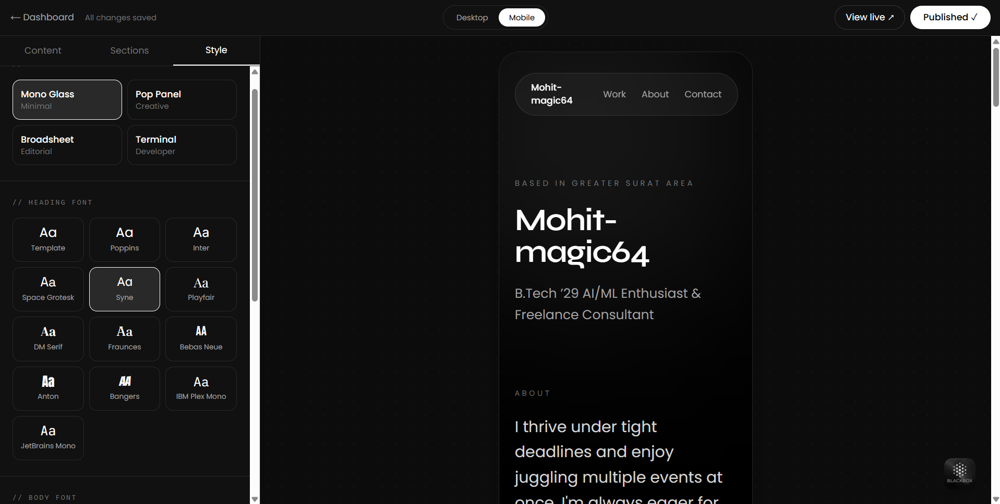
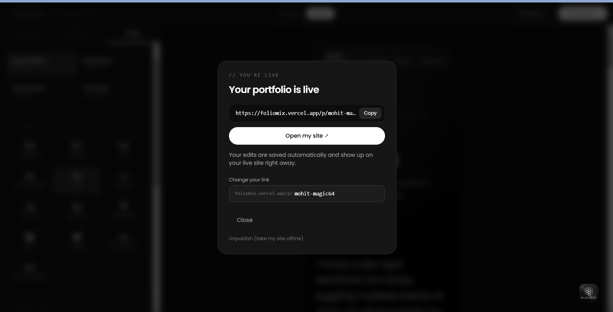
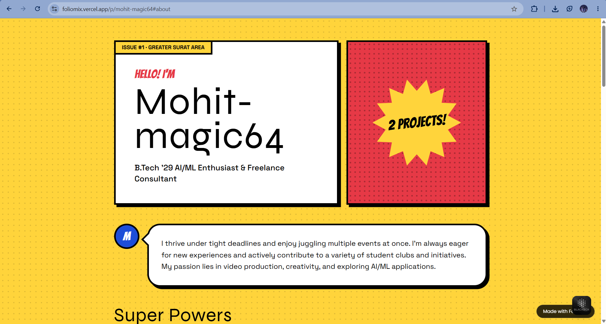
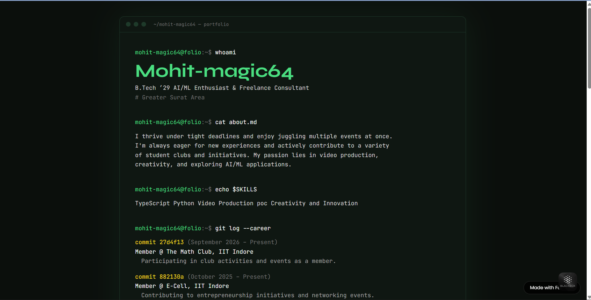

# Foliomix

**Your portfolio, live in minutes. From GitHub or your resume.**

Foliomix turns your GitHub profile or resume into a polished personal portfolio website. Import your work, pick a template, edit with a live preview, and publish to a shareable link in one click. No code, no design skills, no hosting setup.

🔗 **Live app:** [foliomix.vercel.app](https://foliomix.vercel.app)
🎯 **Sample portfolio:**

Built for **Problem Statement 5: Portfolio Site Builder** (Programming Club, IIT Indore, Software Division induction).


<!-- Screenshot: full editor screen, form on the left, preview on the right -->

---

## How It Works

1. **Sign in** with Google or email (passwordless).
2. **Bring your story**: connect GitHub to pull in your projects, or upload your resume and let AI organize it into sections.
3. **Make it yours**: pick a template, then adjust fonts, colours, sections and every line of text.
4. **Go live**: publish in one click and share your link anywhere.

---

## Features

**Import**
- Import projects from your GitHub profile
- Upload a resume and have AI (via Groq) extract it into structured portfolio data
- Everything imported stays fully editable

**Editing**
- Guided editor with sections for basics, links, skills, projects, experience and education
- Add, remove and reorder projects, roles and education entries
- Sections tab to control which sections appear and in what order
- Tag-style input for skills and project tech stacks

**Live preview**
- Preview updates instantly as you type
- Desktop and mobile preview modes
- On phones, switch between Edit and Preview with a bottom toggle

**Styling**
- 4 templates: **Broadsheet**, **Mono**, **PopPanel** and **Terminal**
- Switch templates anytime without losing content
- Custom heading and body fonts
- Accent colour picker with presets (for templates that use colour)
- One-click reset to template defaults

**Saving and publishing**
- Passwordless login with Google or email (Supabase Auth)
- Autosave 0.8 seconds after you stop typing, with a status indicator and retry
- Warning before closing the tab with unsaved changes
- Publish to a public link at `/p/your-name`, with slug validation
- Change your link or unpublish at any time
- Edits appear on the live site automatically, no re-publish needed

---

## Screenshots

| Landing page | Import (GitHub / resume) |
|---|---|
|  |  |
<!-- Left: home page. Right: the screen where users choose GitHub or resume upload -->

| Editor | Template switcher |
|---|---|
|  |  |
<!-- Left: content tab with a few projects filled in. Right: style tab with template grid and font picker -->

| Mobile preview | Publish dialog |
|---|---|
|  |  |
<!-- Left: editor in mobile device mode. Right: the "Your portfolio is live" dialog -->

### Templates

| Broadsheet | Mono |
|---|---|
|  |  |

| PopPanel | Terminal |
|---|---|
|  |  |
<!-- Same portfolio content in each template, so the differences are obvious -->

---

## Tech Stack

| Layer | Technology |
|---|---|
| Framework | Next.js (App Router), React, TypeScript |
| Styling | Tailwind CSS |
| API | Next.js Route Handlers (`/api/...`) |
| Database | Supabase (PostgreSQL) |
| Auth | Supabase Auth (Google OAuth + email) |
| AI | Groq API (resume parsing) |
| Hosting | Vercel |

---

## Project Structure

```
foliomix/
├── frontend/
│   └── src/
│       ├── app/                     # Pages: landing, about, help, login, dashboard, editor, /p/[slug]
│       │   └── api/                 # Route handlers: portfolio save, publish, import
│       ├── components/
│       │   ├── editor/              # Editor, LivePreview, SectionsPanel, form fields
│       │   └── templates/           # Broadsheet, Mono, PopPanel, Terminal, RenderPortfolio, meta
│       └── lib/
│           ├── portfolio.ts         # Data types, slug validation, font options
│           └── fonts.ts             # Font family definitions
├── backend/                         # [Describe, e.g. Supabase SQL schema / migrations]
└── shared/                          # [Describe, e.g. types shared across the app]
```

---

## Design Write-up

### Data model

Each user has one portfolio, made of three parts kept deliberately separate:

**1. Content (`Portfolio`)**: what the person says about themselves.

```ts
Portfolio {
  name, headline, about, location?
  links:      { email?, github?, linkedin?, website? }
  skills:     string[]
  projects:   { title, description, url?, repoUrl?, tech: string[] }[]
  experience: { company, role, start, end?, summary }[]
  education:  { school, degree, year? }[]
}
```

**2. Appearance (`Theme`)**: optional overrides on top of the template.

```ts
Theme {
  headingFont?, bodyFont?, accent?
  [section order / visibility fields]
}
```

**3. Template and publishing**: `templateId`, `slug` and `published`.

These are stored in Supabase per user. 

Keeping content separate from appearance is what makes template switching lossless: a template only *reads* the content, it never changes it. Every `Theme` field is optional, so an empty theme means "use the template's defaults," which is how the reset button works.

### How importing works

Both import paths produce the same `Portfolio` shape, so the editor and templates don't need to know where the data came from.

- **GitHub:** fetches the user's repositories and maps each one to a project (name → title, description, homepage → live link, repo URL → code link, language/topics → tech).
- **Resume:** the uploaded resume's text is sent to a Groq-hosted LLM with instructions to return JSON matching the `Portfolio` type. The response is validated before it's saved. [`GROQ_MODELS` holds a list of models to try in order, so if one is unavailable or rate-limited, the next is used.]

### How templates work

Each template is a React component that receives the same props: `data` (content) and `theme` (overrides).

- `meta.ts` lists every template's id, name, category and default accent colour. Black-and-white templates leave the accent out, and the editor hides the colour picker for them.
- `RenderPortfolio` takes a `templateId` and renders the matching component.
- The **same component** renders both the live preview and the published page at `/p/[slug]`, so what you see while editing is exactly what visitors see.

Adding a new template means writing one component and adding one entry to `meta.ts`.

### Autosave

Every edit updates React state immediately (so the preview is instant) and also copies the latest data into a `useRef`. A debounced timer waits **800 ms** after the last change, then sends one `PATCH /api/portfolio` request. Typing a sentence triggers one save instead of dozens, and the ref guarantees the newest data is always sent.

### How publishing works

1. The user picks a slug. Input is lowercased and invalid characters become `-` as they type, and `slugError()` validates it before the button enables.
2. Before publishing, the editor **forces a save** so no pending edits are lost.
3. `POST /api/portfolio/publish` with `{ slug, publish: true }` marks the portfolio public. [The server rejects slugs that are already taken.]
4. `/p/[slug]` loads the saved data from Supabase and renders it with `RenderPortfolio`.

Because the public page reads live data, later edits show up on the published site automatically.

### API

| Method | Endpoint | Body | Purpose |
|---|---|---|---|
| `PATCH` | `/api/portfolio` | `{ data, theme, templateId }` | Save portfolio (autosave) |
| `POST` | `/api/portfolio/publish` | `{ slug, publish: true }` | Publish or change link |
| `POST` | `/api/portfolio/publish` | `{ publish: false }` | Unpublish |
| [`POST`] | [`/api/import/github`] | [`...`] | [Import projects from GitHub] |
| [`POST`] | [`/api/import/resume`] | [`...`] | [Parse resume with AI] |

---

## Getting Started

### Prerequisites
- Node.js [18] or later
- A free [Supabase](https://supabase.com) project
- A free [Groq](https://console.groq.com) API key

### 1. Clone the repo
```bash
git clone https://github.com/Mohit-magic64/foliomix.git
cd foliomix/frontend
```

### 2. Set up Supabase
1. Create a new Supabase project.
2. [Run the SQL in `backend/schema.sql` in the Supabase SQL editor to create the tables.]
3. Under **Authentication → Providers**, enable **Email** and **Google**.
4. Under **Authentication → URL Configuration**, add `http://localhost:3000` as a redirect URL.

### 3. Add environment variables
Copy `.env.example` to `.env.local` and fill it in:

```env
NEXT_PUBLIC_SUPABASE_URL=        # Supabase → Project Settings → API
NEXT_PUBLIC_SUPABASE_ANON_KEY=   # Supabase → Project Settings → API
GROQ_API_KEY=                    # console.groq.com → API Keys
GROQ_MODELS=                     # [e.g. comma-separated model names]
```

> `.env.local` is git-ignored. Never commit real keys.

### 4. Install and run
```bash
npm install
npm run dev
```
Open [http://localhost:3000](http://localhost:3000).

---

## Deployment

Deployed on **Vercel**:
1. Import the repo into Vercel and set the root directory to `frontend`.
2. Add the four environment variables in **Project Settings → Environment Variables**.
3. Add the Vercel URL to Supabase's allowed redirect URLs so login works in production.

---

## Roadmap

- [ ] Image upload for projects
- [ ] Export portfolio as a standalone HTML/CSS zip
- [ ] Move-down button and drag-and-drop reordering
- [ ] Markdown support in project descriptions
- [ ] SEO fields (title, description, social preview image)
- [ ] Visit analytics for published portfolios

---

## Author

**MOHIT JAIN**
[GitHub](https://github.com/Mohit-magic64) 
